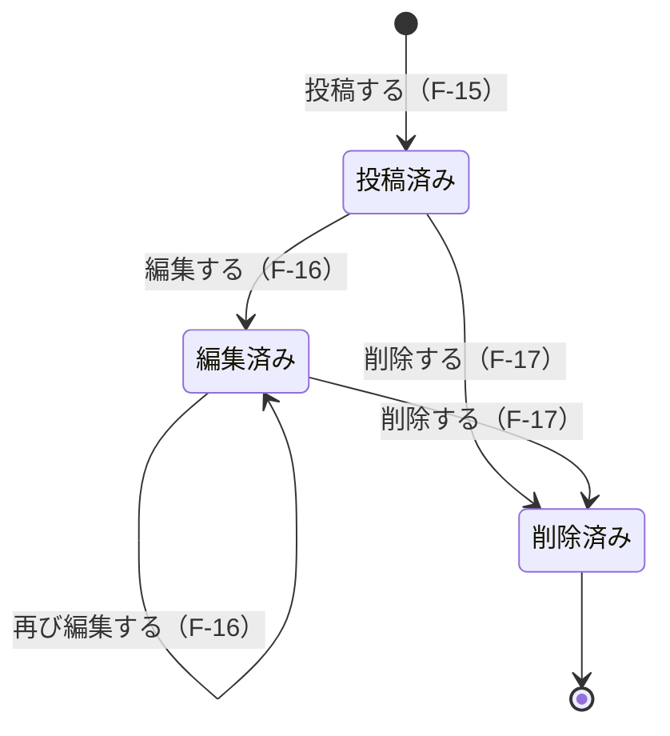
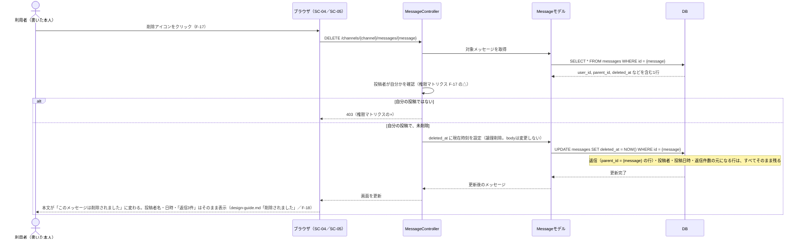

# 状態遷移・シーケンス・例外方針

`features.md`・`questions.md`・`screens.md`・`data.md`・`permissions-api.md` と、`spec.md`・`mockup/` を根拠に作成。
根拠の書き方は他のファイルと同じ。

---

## 1. 状態遷移図（メッセージ）

`docs/design/README.md`「書く量の決まり」のとおり、状態遷移図はメッセージだけに絞る（チャンネルやメンバーには、投稿済み／編集済み／削除済みのような複数状態の遷移が無く、作成・編集・削除で足りるため）。

- **投稿済み**：`deleted_at` も `edited_at` もNULL。本文がそのまま表示される通常の状態。
- **編集済み**：`edited_at` が入っている。本文は最新の内容に変わり、末尾に「編集済み」の印が付く（`spec.md 3-4`）。何度編集しても状態は変わらない。編集できる期間に制限はない（`questions.md`「Qに対応しない回答」4.）。
- **削除済み**：`deleted_at` が入っている（`data.md` の論理削除方式、この会話で確認した案1）。本文は表示されず「このメッセージは削除されました」になる。**削除済みから出ていく遷移は無い**。削除済みのメッセージには編集・削除の操作自体を出さない（`questions.md` Q-08）ため、削除済みは終端状態として扱う。

返信が付くこと自体は、このメッセージの状態を変えない（返信は別の行であり、親のメッセージの `deleted_at`／`edited_at` に影響しない）。削除済みのメッセージにも新しい返信は続けられる（`questions.md`「Qに対応しない回答」5.）ため、「削除済み」であることと「返信を受け付けるか」は別の軸。

---

## 2. シーケンス図（代表）

`docs/design/README.md`「書く量の決まり」のとおり、代表を1本だけ描く。選んだのは「スレッドの返信が付いたメッセージを、書いた本人が削除したとき」。削除（論理削除）・権限チェック・返信との関係（消さずに残す）のすべてが1本で確認できるため。

---

## 3. 例外方針

網羅はせず、方針と代表例だけを書く（個々の画面の入力チェックは `screens.md` 4.、APIのエラーは `permissions-api.md` 3.を参照）。

| 状況 | 返し方 | 根拠・考え方 |
| :-- | :-- | :-- |
| 入力値の検証エラー（未入力・上限超過など） | 画面を再表示し、該当欄にエラー文を出す（`design-guide.md`「入力エラー」の見た目） | `screens.md` 4.の各表のとおり。個別の文言はそちらを参照 |
| 権限が無い操作（他人のメッセージを編集・削除しようとした等） | 403 | `permissions-api.md` 1.の権限マトリクスで×・△の条件を満たさない場合 |
| 対象が見つからない（チャンネル・メッセージのIDが存在しない） | 404 | 通常のRESTの考え方。モックアップにエラー画面の見本は無いため、画面デザインはこの文書では決めない（5.で指摘） |
| 自分がメンバーでないプライベートチャンネルのURLに直接アクセスした | **403ではなく404** | `questions.md`「Qに対応しない回答」1.「そういう部屋があるということ自体が分からない状態にしたい」を、一覧表示だけでなくURLへの直接アクセスにも適用した。403だと「存在はするが見られない」ことが伝わってしまうため。`permissions-api.md` 3.の公開APIで404に統一した判断と揃える |
| 削除済みのメッセージに対する編集・削除の要求（二重クリックなど） | 404（対象が無いのと同じ扱い） | `questions.md` Q-08「削除済みのメッセージには編集・削除の操作自体を出さない」を、画面上の見せ方だけでなく、サーバー側に直接要求が来た場合にも適用した |
| ログインの有効期限切れ（セッションが切れた状態で、ログイン後の画面にアクセスした） | ログイン画面へ送り直す（302リダイレクト） | `auth`ミドルウェアの標準的な動作。もう一度ログインすれば、元にやろうとしていた操作を続けられる |
| CSRFトークンの期限切れ（画面を開いたまま長く放置してから送信した） | 送信そのものを弾く（419）。画面の内容は更新されない | Laravelの標準的なCSRF検証の動作。送信が通らないため、画面を読み込み直してからやり直す必要がある |
| 想定外のサーバーエラー | 500。Laravelの標準的なエラーハンドリングに任せる | `spec.md 3-1`「作り方はお任せします」の範囲内。仕様書・モックアップに具体的な要求が無い |

同時編集・同時削除の競合（排他制御）については、仕様書・モックアップのどちらにも要求が無いため、この文書では設計しない（5.で指摘）。

---

## 4. クラス図について

作らない（`docs/design/README.md`「書く量の決まり」）。LaravelのMVCの標準的な構成（Model = Eloquent、Controller、View = Blade）にそのまま乗る。

---

## 5. 書いていて気づいたこと（指摘）

1. **公開APIのメッセージ一覧に、返信（`parent_id` が入っている行）を含めるかどうかは未確認**：`permissions-api.md` 2.のレスポンス例では、通常のメッセージと返信を区別せずチャンネルの全メッセージを返す前提で書いたが、`spec.md 3-7` は「メッセージの一覧」としか言っておらず、返信を含めるべきかどうかの記載が無い。
2. **公開APIのメッセージの並び順は未確認**：`questions.md`「Qに対応しない回答」6.（画面での並び順：古い→新しい）から類推して同じ並びにしたが、公開API自体の並び順は仕様書に無い。
3. **チャンネル内のメッセージ一覧（SC-04）にページングが無いことも未確認**：`questions.md` Q-10は公開APIについての回答で、画面側のページングは別の話。件数が少ない前提（`spec.md 5-4`）から類推しただけで、直接確認していない。
4. **非メンバーのプライベートチャンネルへの直接アクセスを404にする判断は、まだ確認事項として聞いていない**：3.の「―― 403ではなく404」は、`questions.md`「Qに対応しない回答」1.からの類推で決めたもので、クライアントに直接確認した話ではない。プライバシーに関わる要件なので、確認してもよいと思う。
5. **公開APIのチャンネル一覧のフィールド（名前・説明のみ、作成者は含めない）は、こちらで決めたもの**：`permissions-api.md` 3.に書いたとおり、仕様書に具体的なフィールドの指定は無い。
