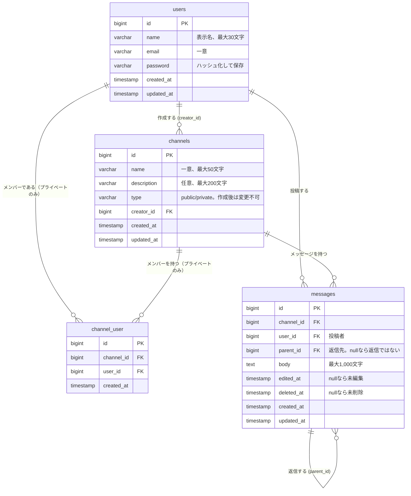

# データ設計

`docs/design/features.md`・`questions.md`・`screens.md` と、`spec.md`・`mockup/` を根拠に、ER図・テーブル定義書・CRUD表を作成した。
根拠の書き方は他のファイルと同じ：`spec.md n-n` ／ `mockup/ファイル名` ／ `questions.md Q-n` ／ `features.md F-n`。

今回のメッセージ削除方式（案1：行を残し、`deleted_at` を持ち、本文はそのまま保持する）は、この会話で確認して決めたもの。`questions.md` Q-13への追記は、ユーザー側で行う前提で、この文書ではその決定を踏まえて設計する。

公開チャンネルの作成者について、`channel_user`（メンバーの行）は作らない、作成者は `channels.creator_id` だけで表す、という方針もこの会話で確認して決めた（`spec.md 3-2`「チャンネルを作った人は、そのチャンネルのメンバーになります」は、3-3の「公開チャンネルは誰でも見られるので、メンバーの追加・削除の操作は要りません」と合わせて読むと、メンバーという操作上の概念はプライベートチャンネルにしか無いと判断した）。

---

## 1. ER図

`channel_user` は、公開チャンネルでは行を作らない（上記方針）。`messages.channel_id` は、返信（`parent_id` が入っている行）にも持たせる。元のメッセージをたどらなくても、そのメッセージがどのチャンネルのものかを直接判定できるようにするため（検索結果にチャンネル名を出す `features.md F-24`、チャンネルごとの一覧表示 `spec.md 3-4` のいずれも、メッセージ単体からチャンネルが分かる必要がある）。

---

## 2. テーブル定義書

### users（社員）

| カラム | 型 | NULL | 制約 | 根拠 |
| :-- | :-- | :-- | :-- | :-- |
| id | bigint | NOT NULL | PK | - |
| name | varchar(30) | NOT NULL | - | 表示名。上限30文字（`spec.md 5-1`） |
| email | varchar | NOT NULL | UNIQUE | 一意（`questions.md` Q-01）。上限の文字数は仕様書に記載がなく、ここでは決めない（4.参照） |
| password | varchar | NOT NULL | - | ハッシュ化して保存。ログインの仕組みは任せられている（`spec.md 3-1`「作り方はお任せします」）。8文字以上は入力チェック側の制約（`spec.md 5-1`）で、カラム自体には上限を設けない |
| created_at / updated_at | timestamp | NOT NULL | - | Laravelの標準的な実装慣習。特定の機能要求からの項目ではない（4.参照） |

登録後に表示名・パスワードを変更する画面は無い（`questions.md`「Qに対応しない回答」9.）ため、UPDATEの導線は今回は無い。

### channels（チャンネル）

| カラム | 型 | NULL | 制約 | 根拠 |
| :-- | :-- | :-- | :-- | :-- |
| id | bigint | NOT NULL | PK | - |
| name | varchar(50) | NOT NULL | UNIQUE | 上限50文字（`spec.md 5-1`）、一意（`questions.md` Q-03） |
| description | varchar(200) | NULL | - | 上限200文字（`spec.md 5-1`）。必須ではない（`mockup/channel-new.html` に `*` が無い） |
| type | enum（`public`/`private`） | NOT NULL | - | `spec.md 3-2`。作成後は変更不可（`questions.md` Q-04）。この制約はアプリ側の更新処理で守るもので、カラムの型だけでは強制できない |
| creator_id | bigint | NOT NULL | FK → users.id | 作成者。`spec.md 3-2`「チャンネルを作った人だけが...直したり、消したりできます」の判定に使う |
| created_at / updated_at | timestamp | NOT NULL | - | Laravelの標準的な実装慣習 |

### channel_user（プライベートチャンネルのメンバー）

| カラム | 型 | NULL | 制約 | 根拠 |
| :-- | :-- | :-- | :-- | :-- |
| id | bigint | NOT NULL | PK | - |
| channel_id | bigint | NOT NULL | FK → channels.id | `spec.md 3-3` |
| user_id | bigint | NOT NULL | FK → users.id | 同上 |
| created_at | timestamp | NOT NULL | UNIQUE(channel_id, user_id) | 同じ人を同じチャンネルに重複して追加しないための制約。いつ追加されたかという表示は、どの画面にも無い（4.参照） |

**公開チャンネルの行は作らない**（今回の会話で確認）。公開チャンネルの閲覧・投稿権限は `channels.type = public` のみで判定し、このテーブルは見ない。

### messages（メッセージ・返信）

返信も同じテーブルで持つ。モックアップ・デザインガイドのどちらでも、返信は「編集・削除・ホバー操作」のすべてがメッセージと同じ扱いであり（`design-guide.md`「メッセージのホバー操作」「編集中（メッセージ）」）、テーブルを分ける根拠が無いため。

| カラム | 型 | NULL | 制約 | 根拠 |
| :-- | :-- | :-- | :-- | :-- |
| id | bigint | NOT NULL | PK | - |
| channel_id | bigint | NOT NULL | FK → channels.id | 1.のとおり、返信にも持たせる |
| user_id | bigint | NOT NULL | FK → users.id | 投稿者。`spec.md 3-4`「誰がいつ書いたのかが分かるように」 |
| parent_id | bigint | NULL | FK → messages.id | 返信先。`spec.md 3-5`。NULLなら通常のメッセージ。返信をさらに返信にできないこと（`questions.md` Q-09）は、アプリ側の作成処理で守る（`parent_id` を持つ行には返信を作らせない） |
| body | text | NOT NULL | - | 上限1,000文字（`spec.md 5-1`）。前後の空白・改行だけの入力は未入力として扱う（`screens.md` 4.の共通ルール） |
| edited_at | timestamp | NULL | - | 編集済みの印（`spec.md 3-4`）。NULLなら未編集。編集できる期間に制限はない（`questions.md`「Qに対応しない回答」4.） |
| deleted_at | timestamp | NULL | - | 削除済みの印。NULLなら未削除。本文(`body`)は削除後も保持する（今回の会話で確認した案1） |
| created_at / updated_at | timestamp | NOT NULL | - | 投稿日時として使用（`spec.md 3-4`）。並び順は古い→新しい（`questions.md`「Qに対応しない回答」6.） |

返信件数は、`parent_id` が自分のidと一致する行を数えて都度算出する（`spec.md 3-5`「返信が何件付いているか」）。件数を別カラムに持たせる根拠はどこにも無いため、持たせない。

---

## 3. CRUD表

行は `features.md` のF-01〜F-31。列はテーブル（users / channels / channel_user / messages）。CRUDの操作がなく、UIの見せ方や権限の話にとどまるものは「―」とし、根拠・理由を備考に書く。

| F-ID | 機能 | users | channels | channel_user | messages | 備考 |
| :-- | :-- | :-- | :-- | :-- | :-- | :-- |
| F-01 | 新規登録 | C | | | | |
| F-02 | ログイン | R | | | | 認証のみ。更新は発生しない |
| F-03 | ログアウト | | | | | ― 対象テーブルなし。セッションの破棄のみで、どのテーブルも操作しない |
| F-04 | チャンネルの作成 | | C | C | | `channel_user`は**プライベートのみ**、作成者の1行を作る（公開は作らない。1.参照） |
| F-05 | 作成者は自動的にメンバーになる | | | | | ― F-04の`channel_user`へのCと同じ操作。独立したCRUDは発生しない |
| F-06 | チャンネルの編集 | | U | | | `type`列は更新対象から除く（F-10） |
| F-07 | チャンネルの削除 | | D | D | D | 中のメッセージ・返信・メンバー行も一緒に物理削除する。「一緒に消えて構いません」「戻せない」（`questions.md`「Qに対応しない回答」2.）という回答から、こちらは論理削除ではなく実際の削除（DELETE）と判断した |
| F-08 | 公開チャンネルの閲覧・投稿権 | | | | | ― 権限の判定（`type=public`）の話。CRUDはF-15・F-20のRと同じ |
| F-09 | プライベートチャンネルの閲覧・投稿権 | | | R | | `channel_user`を読んで、閲覧・投稿を許すかどうかを判定する |
| F-10 | 公開範囲は作成後変更不可 | | | | | ― F-06のUに対する制約（`type`列を更新させない）。独立したCRUDは発生しない |
| F-11 | チャンネル一覧の表示 | | R | R | | `channel_user`は、自分が入っているプライベートチャンネルを判定するために読む |
| F-12 | メンバーの追加 | | | C | | |
| F-13 | メンバーの削除 | | | D | | |
| F-14 | 公開チャンネルにはメンバー管理の操作がない | | | | | ― 操作自体が存在しない |
| F-15 | メッセージの投稿 | | | | C | |
| F-16 | メッセージの編集 | | | | U | `edited_at`を設定する |
| F-17 | メッセージの削除 | | | | U | **論理削除**。`deleted_at`を設定するだけで、DELETEは発行しない（今回確認した案1） |
| F-18 | 削除済みメッセージの表示保持 | | | | R | ― F-17のUのあとの読み取り方の話。独立したCRUDは発生しない |
| F-19 | ホバー操作の表示制御 | | | | | ― 画面の見せ方のみ。CRUDは発生しない |
| F-20 | メッセージへの返信 | | | | C | `parent_id`を設定する |
| F-21 | 返信は別パネルに表示 | | | | | ― F-20の読み取り先（表示場所）の話。独立したCRUDは発生しない |
| F-22 | 返信件数の表示 | | | | R | `parent_id`で数える集計 |
| F-23 | キーワード検索 | | R | R | R | `channels`はチャンネル名の表示、`channel_user`は閲覧できる範囲の判定に使う |
| F-24 | 検索結果の強調表示 | | | | | ― F-23のRの表示の話。独立したCRUDは発生しない |
| F-25 | 検索結果を見られるチャンネルに限定 | | | | | ― F-23のRに対する絞り込み条件。独立したCRUDは発生しない |
| F-26 | 検索結果が0件のときの表示 | | | | | ― 画面の見せ方のみ |
| F-27 | 公開API：公開チャンネル一覧 | | R | | | |
| F-28 | 公開API：指定公開チャンネルのメッセージ一覧 | | | | R | 削除済みメッセージは結果から除外する（`questions.md` Q-11） |
| F-29 | 公開APIにプライベートの情報を含めない | | | | | ― F-27・F-28のRに対する絞り込み条件。独立したCRUDは発生しない |
| F-30 | 文字数上限の適用 | | | | | ― 2.の各カラムの型・上限に反映済み。独立した行としてのCRUDは発生しない |
| F-31 | 初期データ投入 | C | C | C | C | 画面操作によるCRUDではなく、シーダーなどでの投入を想定。この表の対象（画面からのCRUD）には本来含まれないが、行として指摘しておく |

---

## 4. 埋まらなかった点・指摘事項

書きながら、根拠が無くて埋められなかった・判断が必要だった点。

1. **メールアドレスの最大文字数**：`spec.md 5-1` の文字数上限の表に、メールアドレスは載っていない。`mockup/register.html` にも上限の見本がない。そのため `users.email` のカラム長は、この文書では決めていない（よくある255等の値を当てはめることはしていない）。
2. **各テーブルの `created_at`／`updated_at`**：Laravelでテーブルを作るときの標準的な項目として置いたが、これ自体を要求している機能は無い（`channel_user.created_at` も同様で、「いつ追加されたか」を表示する画面は無い）。実装時にこの項目が本当に要るかどうかは、あらためて判断してよい。
3. **F-05・F-10・F-14・F-18・F-19・F-21・F-24・F-25・F-26・F-30 は、CRUD表の上では独立した操作を持たない**：これらは機能一覧には載っているが、実体としては他のF-IDの操作（C/R/U/D）の一部か、画面の見せ方・絞り込み条件にとどまる。そのまま空欄にせず、備考に理由を書いた。
4. **F-31（初期データ投入）**：画面を使ったCRUDではないため、本来この表の対象ではない。行としては載せたが、各セルは「シーダーで一括投入する」という意味で書いており、画面操作のCRUDとは性質が違う。
5. **F-07（チャンネル削除）を論理削除ではなく物理削除と判断した根拠**：`questions.md`「Qに対応しない回答」2.の「一緒に消えて構いません。ただ、うっかり消してしまうと戻せないので」という文言から、取り消せない（＝実際に消える）操作と読んだ。これは今回の会話で決めたメッセージ単体の削除（案1・論理削除）とは別の判断なので、混同しないよう3.の備考に明記した。
