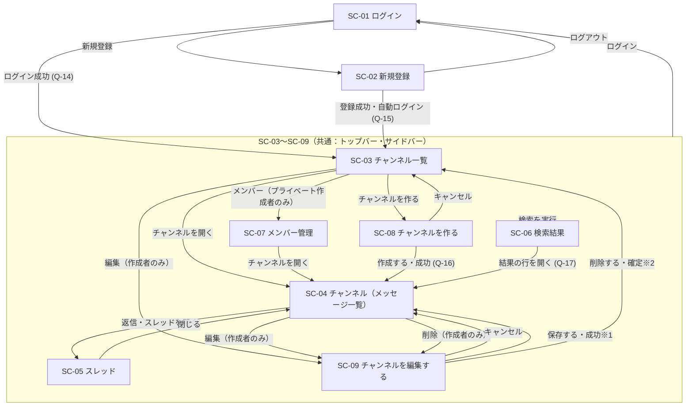

# 画面設計

`mockup/`（9画面 + `design-guide.md`）と `docs/spec.md`、`docs/design/questions.md`（クライアントの回答・自分で決めたこと）を突き合わせて作成。
モックアップが最初から存在するため、ワイヤーフレームは描かず、モックアップを正としてそのまま画面一覧・画面遷移図・画面項目定義・入力チェックに落とす。

根拠の書き方：`spec.md n-n` ／ `mockup/ファイル名` ／ `design-guide.md「見出し」` ／ `questions.md Q-n`。根拠が無く、こちらで確認して決めたものには、その旨を明記する。

---

## 1. 画面一覧

| ID | 画面名 | 対応モックアップ | 入れる人 | 概要 |
| :-- | :-- | :-- | :-- | :-- |
| SC-01 | ログイン | `login.html` | ログインしていない人 | メールアドレス・パスワードでログイン |
| SC-02 | 新規登録 | `register.html` | ログインしていない人 | 表示名・メールアドレス・パスワードで新規登録 |
| SC-03 | チャンネル一覧 | `channels.html` | ログイン済みの社員 | 自分が見られるチャンネル（公開全部＋自分がメンバーのプライベート）の一覧 |
| SC-04 | チャンネル（メッセージ一覧） | `channel-show.html` | そのチャンネルを閲覧できる人（公開は全員、プライベートはメンバーのみ） | メッセージの一覧表示・投稿・編集・削除 |
| SC-05 | スレッド | `thread.html` | SC-04 と同じ | SC-04 の右側に開く返信専用パネル（SC-04の状態の一つ。別URLの画面ではない） |
| SC-06 | 検索結果 | `search.html` | ログイン済みの社員 | キーワードによるメッセージ検索の結果 |
| SC-07 | メンバー管理 | `members.html` | そのプライベートチャンネルの作成者のみ | プライベートチャンネルのメンバー追加・削除 |
| SC-08 | チャンネルを作る | `channel-new.html` | ログイン済みの社員 | チャンネルの新規作成（名前・説明・公開/プライベート） |
| SC-09 | チャンネルを編集する | `channel-edit.html` | そのチャンネルの作成者のみ | チャンネルの名前・説明の編集、削除 |

※ SC-05（スレッド）は `mockup/README.md` でも「チャンネルの右側に開くパネル」と説明されており、独立した画面ではなくSC-04の状態として扱う。

---

## 2. 画面共通要素（SC-03〜SC-09）

ログイン後の画面（SC-03〜SC-09）はすべて同じ外枠を共有する（`mockup/channels.html` 等、全ページ共通のHTML構造より）。

### トップバー
- ブランド表示「チ チームチャットアプリ」
- 検索ボックス（プレースホルダ「メッセージを検索」）：キーワードを入力して実行すると SC-06 に移動する
- ログイン中の表示名
- 「ログアウト」：押すとSC-01へ戻る。確認ダイアログの見本は無く、即座にログアウトする（モックアップ・仕様書に確認手順の記載なし）

### サイドバー
- 「チャンネル」の見出し
- 自分が見られるチャンネルの一覧（`#`＝公開、鍵アイコン＝プライベート）。**自分がメンバーでないプライベートチャンネルは、名前も含めて一切表示しない**（`questions.md`「Qに対応しない回答」1.：「入っていないプライベートチャンネルは...チャンネルの一覧にも出さないでください」）
- 今開いているチャンネルは選択中の見た目（`design-guide.md`「選択中（サイドバー）」）
- 末尾に「チャンネル一覧を見る」リンク → SC-03

SC-01・SC-02 にはこの外枠はない（`mockup/login.html`・`register.html` は専用のカード型レイアウト）。

---

## 3. 画面遷移図

- `(Q-n)`：`questions.md` のQ-14〜Q-17で確認して決めたもの
- `※1` 保存成功後の遷移先はモックアップに見本がないが、`channel-edit.html` の「キャンセル」が SC-04 に戻ることと対にして、保存成功時も同じ SC-04 に戻るとした（確認するほどの分岐ではないと判断）
- `※2` 削除確定後の遷移先もモックアップに見本がないが、削除したチャンネルの画面（SC-04）はもう存在しないため、必然的に SC-03 に戻るとした

---

## 4. 画面項目定義・入力チェックとエラーメッセージ

### 書く範囲について（選んだ理由）

`docs/design/README.md` の「書く量の決まり」に従い、**入力フォームを持つ画面だけ**に項目定義と入力チェックの表を作る。理由：
- SC-03（チャンネル一覧）は一覧表示とリンクのみでフォームが無いため、2.の共通要素と1.の画面一覧で説明済みとし、個別の項目定義は作らない
- SC-05（スレッド）は投稿欄・編集ともSC-04と全く同じ型（`mockup/thread.html` の `composer` は `channel-show.html` と同一のマークアップ）なので、「SC-04と同じ」として済ませる
- 残りの6画面（SC-01・SC-02・SC-04・SC-06・SC-07・SC-08・SC-09）は、いずれも入力チェック・エラー表示を持つため、個別に書く

文字数の上限はすべて `spec.md 5-1` の値をそのまま使う。空欄のまま送信したときの扱いは `spec.md 5-1`「長すぎる入力や、空のままの送信をどう扱うかは、使う人が困らない形にしてください」により、デザインガイドの状態（押せない無効ボタン／赤枠エラー）のどちらかをこちらで選ぶ。エラー文の言い回しは、モックアップに実在する文言（「チャンネル名を入力してください」等）と同じ型（1文・句点なし・「〜してください」）に揃える。

**空白だけの入力について**：どの必須チェックも、入力値の前後にある空白・改行を取り除いたうえで、空かどうかを判定する（半角スペース・全角スペース・改行だけの入力は、未入力と同じに扱う）。以下の各表の「未入力」「空」は、すべてこの判定のあとの話とする。

誰がその操作をできるか（権限）は、この節の表には含めない。権限は別の設計書（権限マトリクス）であとで決める。

---

### 4-1. SC-01 ログイン（`mockup/login.html`）

| 項目 | 種別 | 必須 | 上限 | 備考 |
| :-- | :-- | :-- | :-- | :-- |
| メールアドレス | テキスト | ○ | - | - |
| パスワード | パスワード | ○ | - | - |

入力チェックとエラーメッセージ：

| 条件 | メッセージ | 根拠 |
| :-- | :-- | :-- |
| メールアドレス未入力 | 「メールアドレスを入力してください」 | `spec.md 5-1`（空欄送信の扱い）＋ モックアップのエラー文の型 |
| パスワード未入力 | 「パスワードを入力してください」 | 同上 |
| メールアドレス・パスワードの組み合わせが正しくない | 「メールアドレスまたはパスワードが正しくありません」 | `mockup/login.html`（パスワード欄に表示されている実際の文言） |

---

### 4-2. SC-02 新規登録（`mockup/register.html`）

| 項目 | 種別 | 必須 | 上限 | 備考 |
| :-- | :-- | :-- | :-- | :-- |
| 表示名 | テキスト | ○ | 30文字 | `spec.md 5-1` |
| メールアドレス | テキスト | ○ | - | 登録済みのものは使えない（`questions.md` Q-01） |
| パスワード | パスワード | ○ | 8文字以上（上限なし） | `spec.md 5-1` |
| パスワード（確認用） | パスワード | ○ | - | パスワードと一致すること（`questions.md` Q-02） |

入力チェックとエラーメッセージ：

| 条件 | メッセージ | 根拠 |
| :-- | :-- | :-- |
| 表示名未入力 | 「表示名を入力してください」 | `spec.md 5-1` |
| 表示名が30文字を超える | 「表示名は30文字以内で入力してください」 | `spec.md 5-1` |
| メールアドレス未入力 | 「メールアドレスを入力してください」 | `spec.md 5-1` |
| メールアドレスの形式が不正 | 「メールアドレスの形式で入力してください」 | メールアドレス欄として機能上必要な形式チェック |
| メールアドレスが登録済み | 「このメールアドレスは既に登録されています」 | `questions.md` Q-01（クライアント回答の文言をそのまま使用） |
| パスワード未入力 | 「パスワードを入力してください」 | `spec.md 5-1` |
| パスワードが8文字未満 | 「パスワードは8文字以上で入力してください」 | `spec.md 5-1` |
| パスワード（確認用）未入力 | 「確認用のパスワードを入力してください」 | `spec.md 5-1` |
| パスワードと確認用が一致しない | 「パスワードが一致しません」 | `questions.md` Q-02 |

表示名の入力欄の下に「n / 30」の文字数表示（`mockup/register.html` の `count`）。

---

### 4-3. SC-04 チャンネル（メッセージ一覧）（`mockup/channel-show.html`）

メッセージの並び順は古い→新しい（`questions.md`「Qに対応しない回答」6.）。削除済みメッセージでも投稿者名・日時・返信件数は表示を残す（`design-guide.md`「削除されました」／F-18）。返信が1件以上あるときだけ本文下に「返信n件」を表示する（`mockup/channel-show.html` では返信のないメッセージにリンクが出ていない）。

#### 投稿欄

| 項目 | 種別 | 必須 | 上限 | 備考 |
| :-- | :-- | :-- | :-- | :-- |
| メッセージ本文 | テキストエリア | ○ | 1,000文字 | `spec.md 5-1` |

| 条件 | 扱い | 根拠 |
| :-- | :-- | :-- |
| 本文が空（前後の空白・改行だけの入力を含む） | 送信ボタンを無効化する（エラー文は出さない） | `spec.md 5-1` の委任を受けて、`design-guide.md`「押せない（無効）」の形を採用 |
| 1,000文字に達する | 入力欄下の文字数表示が「1,000 / 1,000 文字」になり、以降の入力を止める（`maxlength`相当） | `design-guide.md`「文字数」（入力に追随させる形） |

#### メッセージ・返信の編集（自分の投稿のみ）

本文の場所がテキストエリアに変わり、下に「保存」（塗り）「やめる」を並べる（`design-guide.md`「編集中（メッセージ）」）。上限はメッセージ本文と同じ1,000文字（`spec.md 5-1`）。保存すると本文末尾に「 編集済み」が付く（既に付いている場合はそのまま）。編集できる期間に制限はない（`questions.md`「Qに対応しない回答」4.）。SC-05（スレッド）の返信も、同じ仕組みでその場編集する。

| 条件 | 扱い | 根拠 |
| :-- | :-- | :-- |
| 本文が空になる（前後の空白・改行だけの入力を含む） | 「保存」ボタンを無効化する（エラー文は出さない） | 投稿欄の「本文が空」と同じ扱い（`spec.md 5-1`、`design-guide.md`「押せない（無効）」） |
| 1,000文字に達する | 入力欄下の文字数表示が「1,000 / 1,000 文字」になり、以降の入力を止める | 投稿欄と同じ（`design-guide.md`「文字数」） |

#### メッセージの削除（自分のメッセージのみ）

削除すると、その場所が「このメッセージは削除されました」に変わる（`spec.md 3-4`）。チャンネル削除のような入力確認はモックアップに見本がなく、即時削除とする。削除済みのメッセージは編集・削除の操作自体を出さない（`questions.md` Q-08）。削除済みのメッセージにも返信は続けられる（`questions.md`「Qに対応しない回答」5.）。

#### 返信・編集・削除の操作ボタン

マウスを乗せたときだけ、行の右上に表示する。返信は誰のメッセージにも出すが、編集・削除は自分のメッセージにのみ出す（`design-guide.md`「メッセージのホバー操作」）。

---

### 4-4. SC-06 検索結果（`mockup/search.html`）

| 項目 | 種別 | 必須 | 上限 | 備考 |
| :-- | :-- | :-- | :-- | :-- |
| キーワード | テキスト | ○ | - | - |

| 条件 | 扱い | 根拠 |
| :-- | :-- | :-- |
| キーワードが空 | 検索ボタンを無効化する | `spec.md 5-1` の委任を受けて、投稿欄と同じ扱いに揃える |
| 一致するメッセージが0件 | 「"キーワード"に一致するメッセージはありません」＋「別のキーワードで試すか、キーワードを短くしてください。」 | `mockup/search.html` のそのままの文言 |

検索対象はメッセージ本文のみ（`questions.md` Q-06）。結果は投稿日時が新しい順（`questions.md` Q-07）。結果に出るのは、検索した人が見られるチャンネル（公開＋自分がメンバーのプライベート）のメッセージのみ（`spec.md 3-6`）。一致した語を `<mark>` で強調する（`mockup/search.html`）。各行はクリックでき、そのメッセージのあるチャンネル（SC-04）を開く（`questions.md` Q-17）。

---

### 4-5. SC-07 メンバー管理（`mockup/members.html`）

| 項目 | 種別 | 必須 | 上限 | 備考 |
| :-- | :-- | :-- | :-- | :-- |
| 表示名またはメールアドレス | テキスト | ○ | - | 完全一致のみ（`questions.md` Q-05） |

| 条件 | メッセージ | 根拠 |
| :-- | :-- | :-- |
| 未入力 | 「表示名またはメールアドレスを入力してください」 | `spec.md 5-1` |
| 完全一致する社員が見つからない | 「該当する社員が見つかりません」 | モックアップに見本はないが、完全一致方式（Q-05）を採った以上、不一致時の案内は必要と判断 |
| すでにそのチャンネルのメンバーである社員を指定 | 「すでにメンバーです」 | 同上の理由で必要と判断 |

メンバーの削除（「外す」）には入力確認はない（即時）。この画面を開けるのは、そのプライベートチャンネルの作成者のみ（`mockup/members.html` の注記）。誰を外せるか・外せないか（作成者自身は外せない等）は権限の話なので、この節の表には含めず、別の設計書（権限マトリクス）であとで決める。

---

### 4-6. SC-08 チャンネルを作る（`mockup/channel-new.html`）

| 項目 | 種別 | 必須 | 上限 | 備考 |
| :-- | :-- | :-- | :-- | :-- |
| チャンネル名 | テキスト | ○ | 50文字 | 重複不可（`questions.md` Q-03） |
| 説明 | テキストエリア | - | 200文字 | `spec.md 5-1` |
| 公開範囲 | ラジオ（公開／プライベート） | ○ | - | 既定値「公開」（`mockup/channel-new.html`）。作成後は変更不可（`questions.md` Q-04） |

入力チェックとエラーメッセージ：

| 条件 | メッセージ | 根拠 |
| :-- | :-- | :-- |
| チャンネル名未入力 | 「チャンネル名を入力してください」 | `mockup/channel-new.html` のそのままの文言 |
| チャンネル名が50文字を超える | 「チャンネル名は50文字以内で入力してください」 | `spec.md 5-1` |
| チャンネル名が既に使われている | 「このチャンネル名は既に使われています」 | `questions.md` Q-03（重複不可の決定を受けて） |
| 説明が200文字を超える | 「説明は200文字以内で入力してください」 | `spec.md 5-1` |

入力欄の下に「n / 50」「n / 200」の文字数表示（`mockup/channel-new.html` の `count`）。作成すると、作成した人がそのチャンネルの最初のメンバーになる（`spec.md 3-2`）。作成成功後は、作成したそのチャンネル（SC-04）を開く（`questions.md` Q-16）。

---

### 4-7. SC-09 チャンネルを編集する（`mockup/channel-edit.html`）

#### 編集フォーム

| 項目 | 種別 | 必須 | 上限 | 備考 |
| :-- | :-- | :-- | :-- | :-- |
| チャンネル名 | テキスト | ○ | 50文字 | 自分自身を除いて重複不可（`questions.md` Q-03） |
| 説明 | テキストエリア | - | 200文字 | `spec.md 5-1` |
| 公開範囲 | 表示のみ（変更不可） | - | - | 「公開チャンネルです。公開範囲はあとから変更できません。」（`mockup/channel-edit.html`）。プライベート側の文言はモックアップに見本がないため、同じ型で「プライベートチャンネルです。公開範囲はあとから変更できません。」とする（`questions.md` Q-04からの類推） |

入力チェックとエラーメッセージは、SC-08（チャンネルを作る）のチャンネル名・説明と同じ（「チャンネル名を入力してください」「チャンネル名は50文字以内で入力してください」「このチャンネル名は既に使われています」「説明は200文字以内で入力してください」）。保存成功後はそのチャンネルの画面（SC-04）に戻る（3.の※1）。

#### チャンネルの削除

| 項目 | 種別 | 必須 | 備考 |
| :-- | :-- | :-- | :-- |
| 確認用の入力欄 | テキスト | ○ | 入力値がチャンネル名と完全に一致すること |

| 条件 | 扱い | 根拠 |
| :-- | :-- | :-- |
| 入力値がチャンネル名と一致しない | 「削除する」ボタンを無効化する（エラー文は出さない） | `mockup/channel-edit.html`「確認のためチャンネル名を入力してください」＋ `design-guide.md`「押せない（無効）」 |

削除すると、チャンネルとその中のメッセージ・返信もすべて削除される（`questions.md`「Qに対応しない回答」2.）。削除前に「メッセージn件と返信n件も削除されます。この操作は取り消せません。」という案内を出す（`mockup/channel-edit.html` のそのままの文言）。削除確定後はチャンネル一覧（SC-03）に戻る（3.の※2）。この画面を開けるのは、そのチャンネルの作成者のみ（`spec.md 3-2`）。
